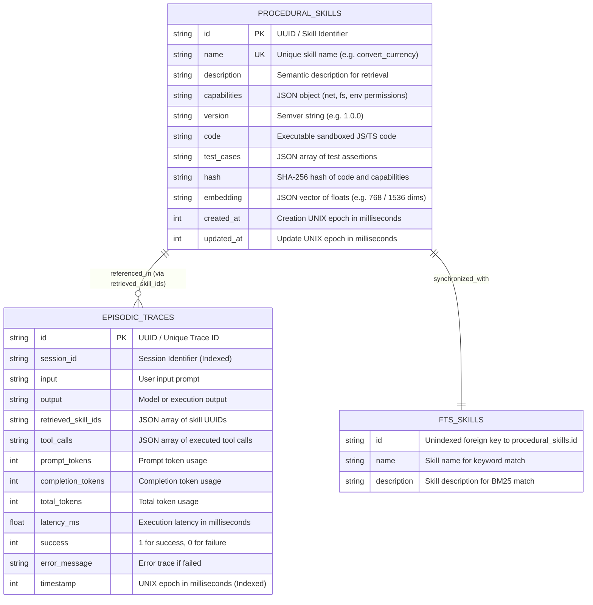

# Entity Relationship Diagram (ERD): OpenTalon Memory Engine

## 1. Overview & Data Architecture
The OpenTalon memory subsystem (`@opentalon/memory`) is built on **libSQL / SQLite** for deterministic, zero-latency in-process storage and hybrid search. It maintains two primary operational datasets:
1. **Episodic Traces (`episodic_traces`)**: Immutable audit log of every Fast Path agent interaction, including prompt/completion token counts, retrieved skill IDs, executed tool calls, latency, and success status.
2. **Procedural Memory (`procedural_skills`)**: Versioned repository of dynamic procedural skills, metadata, capability constraints, executable code, and vector embeddings.
3. **Full-Text Search Index (`fts_skills`)**: SQLite FTS5 virtual table synchronized with procedural skills to provide sub-millisecond keyword BM25 ranking for hybrid retrieval.

---

## 2. Mermaid Entity Relationship Diagram



---

## 3. Detailed Table Specifications & DDL

### 3.1 `episodic_traces`
Records all telemetry and execution artifacts from agent turns. Used by the Slow Path reflection loop to identify recurring patterns, extract heuristics, and audit compliance.

```sql
CREATE TABLE IF NOT EXISTS episodic_traces (
    id TEXT PRIMARY KEY,
    session_id TEXT NOT NULL,
    input TEXT NOT NULL,
    output TEXT NOT NULL,
    retrieved_skill_ids TEXT NOT NULL, -- JSON: string[]
    tool_calls TEXT NOT NULL,          -- JSON: Array<{ toolName: string, args: Record<string, unknown>, result: unknown, durationMs: number }>
    prompt_tokens INTEGER NOT NULL,
    completion_tokens INTEGER NOT NULL,
    total_tokens INTEGER NOT NULL,
    latency_ms REAL NOT NULL,
    success INTEGER NOT NULL,          -- 0 or 1
    error_message TEXT,
    timestamp INTEGER NOT NULL         -- UNIX ms
);

CREATE INDEX IF NOT EXISTS idx_traces_session ON episodic_traces(session_id);
CREATE INDEX IF NOT EXISTS idx_traces_timestamp ON episodic_traces(timestamp DESC);
```

### 3.2 `procedural_skills`
Stores synthesized and pre-packaged procedural capabilities. Each skill has an immutable SHA-256 content hash and explicit capability whitelist.

```sql
CREATE TABLE IF NOT EXISTS procedural_skills (
    id TEXT PRIMARY KEY,
    name TEXT UNIQUE NOT NULL,
    description TEXT NOT NULL,
    capabilities TEXT NOT NULL,        -- JSON: { net?: { allowedHosts: string[], allowHttp?: boolean }, fs?: { readPaths: string[], writePaths: string[] }, env?: string[] }
    version TEXT NOT NULL,             -- Semver
    code TEXT NOT NULL,                -- JavaScript / TypeScript module source
    test_cases TEXT,                   -- JSON: Array<{ input: Record<string, unknown>, expected: unknown }>
    hash TEXT NOT NULL,                -- SHA-256 hash
    embedding TEXT,                    -- JSON: number[] (vector floats)
    created_at INTEGER NOT NULL,       -- UNIX ms
    updated_at INTEGER NOT NULL        -- UNIX ms
);
```

### 3.3 `fts_skills` (Virtual Full-Text Search Table)
Provides BM25 tokenized text matching using SQLite's native FTS5 extension.

```sql
CREATE VIRTUAL TABLE IF NOT EXISTS fts_skills USING fts5(
    id UNINDEXED,
    name,
    description,
    tokenize = 'unicode61'
);
```

---

## 4. Query & Synchronization Patterns

### 4.1 Hybrid Retrieval Query Flow
```
Incoming User Query
         │
         ├───► FTS5 BM25 Search:
         │     SELECT id, rank FROM fts_skills WHERE fts_skills MATCH ? ORDER BY rank LIMIT 20;
         │
         ├───► Vector Embedding Search:
         │     Compute cosine_similarity(query_vector, skill.embedding) for candidates
         │
         └───► Reciprocal Rank Fusion (RRF):
               Score(d) = 1 / (60 + rank_fts) + 1 / (60 + rank_vec)
               Order by Score DESC LIMIT K (default K=3)
```

### 4.2 Procedural Skill Invalidation & Rollback
When a skill fails validation during Slow Path reflection or test execution:
1. The transaction is aborted.
2. The `procedural_skills` row remains at the previous valid semantic version.
3. The `fts_skills` index retains the previous valid descriptor.
4. An error trace is logged into `episodic_traces` with `success = 0`.
