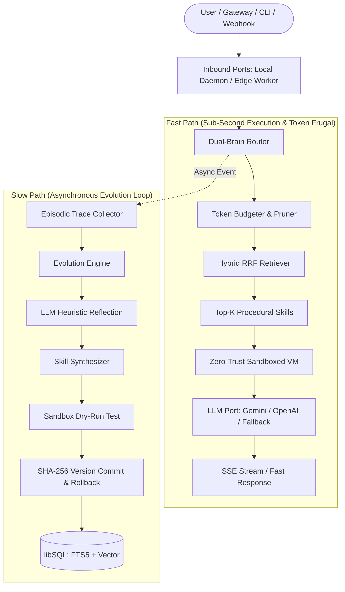

<p align="center">
  
</p>

<p align="center">
  <strong>Next-Generation, Self-Evolving & Hyper-Frugal AI Agent Framework</strong><br>
  <em>Combining Hermes-style procedural memory evolution with OpenClaw token frugality under Zero-Trust sandboxing.</em>
</p>

[](LICENSE)
[](https://www.typescriptlang.org/)
[](https://nodejs.org/)
[](https://turso.tech/libsql)
[](https://modelcontextprotocol.io/)

---

## 🌟 Why OpenTalon?

| Capability | Legacy Frameworks | Hermes Agent | OpenClaw | **OpenTalon** |
|---|---|---|---|---|
| **Token Economy** | 8k–30k tokens/turn | Variable | <2,000 tokens/turn | **<1,500 tokens/turn (Fast Path)** |
| **Skill Evolution** | Static prompts | Autonomous reflection | Manual tools | **Autonomous Slow Path with Rollback** |
| **Tool Execution** | Unchecked / Raw shell | Raw shell / High risk | Node plugins / Permissive | **Zero-Trust Sandboxed VMs (net/fs/env)** |
| **Architecture** | Monolithic / Framework-locked | Local Python daemon | Node CLI | **Hexagonal Ports & Adapters (Local + Serverless)** |
| **Storage Engine** | External Vector DB + SQL | Local JSON / SQLite | Memory cache | **Unified libSQL (FTS5 BM25 + Vector RRF)** |
| **Multi-Agent Swarm** | Add-on orchestrators | Single-agent | Gateway multi-agent | **Native Topologies (FanOut, Saga, Critic)** |
| **Model Context Protocol** | Partial / Manual | None | Community plugin | **Native MCP v1.x Server & Client** |

---

## 🏗️ Architecture Overview

OpenTalon uses a **Hexagonal Ports & Adapters** architecture with a **Dual-Brain execution protocol**:



---

## 📦 Monorepo Structure

```text
opentalon/
├── packages/
│   ├── core/              # DualBrainRouter, LLM Port drivers, EvolutionEngine, McpServer, SwarmDirector
│   ├── memory/            # LibSqlMemoryAdapter, FTS5 BM25 + Vector Cosine, Reciprocal Rank Fusion (RRF)
│   ├── skill-engine/      # SandboxedVmRunner, VirtualFs, CapabilityValidator, SkillSynthesizer, VersionManager
│   ├── gateway/           # LocalDaemonAdapter, ServerlessEdgeAdapter, SseStreamAdapter, Web Dashboard
│   └── cli/               # Binary CLI executable `talon` (init, run, chat, serve, dashboard, mcp, swarm, evolve)
├── examples/skills/       # Production skill gallery (currency, http-fetcher, sanitizer, csv, crypto, stats)
├── specs/                 # Spec-Driven Development architectural specifications
├── deployments/
│   ├── cloudflare-worker/ # Cloudflare Workers edge deployment template
│   └── docker/            # Production multi-stage Dockerfile and Docker Compose
```

---

## 🚀 Quick Start

### 1. Prerequisites
- **Node.js**: v22.0.0 or later
- **pnpm**: v9.0.0 or later

### 2. Installation & Build

```bash
# Clone the repository
git clone https://github.com/roedyrustam/opentalon.git
cd opentalon

# Install all dependencies
pnpm install

# Run comprehensive test suite (69 tests across 11 test suites)
pnpm test

# Build all packages
pnpm build
```

### 3. Initialize & Configure

```bash
# Create local configuration file
pnpm talon init

# Set your API keys in .env
cp .env.example .env
# Edit .env with your GEMINI_API_KEY or OPENAI_API_KEY
```

---

## 💻 CLI Commands

OpenTalon provides a unified CLI binary: `talon` (or `pnpm talon` in development):

```bash
# 1. Single-shot prompt execution
pnpm talon run "What is the exchange rate for 100 USD to IDR?"

# 2. Interactive REPL Chat
pnpm talon chat

# 3. Start Local HTTP Daemon with SSE and REST API
pnpm talon serve --port 8420

# 4. Open Built-In Zero-Dependency Dark-Mode Web Dashboard
pnpm talon dashboard --port 8420

# 5. Run MCP v1.x Server via Stdio for Claude Desktop or Cursor
pnpm talon mcp

# 6. Trigger Autonomous Hermes-Style Skill Evolution
pnpm talon evolve

# 7. Execute Multi-Agent Swarm Topologies
pnpm talon swarm fanout "Analyze cybersecurity posture and compile remediation plan"
pnpm talon swarm saga "Analyze data -> Generate report -> Sign cryptographic hash"
pnpm talon swarm critic "Generate high-frequency trading algorithm with strict risk checks"

# 8. Manage Skills
pnpm talon skills list
pnpm talon skills add examples/skills/currency-converter.md
```

---

## 🛡️ Zero-Trust Capability Sandbox

Every skill executed by OpenTalon runs in an isolated VM context with strict capability gating:

```yaml
---
name: fetch_external_api
description: Securely queries authorized third-party APIs
version: 1.0.0
capabilities:
  network:
    allowedHosts:
      - api.exchangerate.host
      - api.github.com
  filesystem:
    read:
      - /data/cache
    write:
      - /data/reports
  env:
    - ALLOWED_API_KEY
---
```

If a skill attempts to access unauthorized network endpoints, arbitrary disk paths, or undeclared environment variables, OpenTalon instantly blocks the execution with a `CapabilityViolationError` before any syscall can reach the host OS.

---

## 🧠 Dual-Brain Evolution Loop

When a user query encounters missing skills or edge cases:
1. **Fast Path** answers using best-effort synthesis or falls back gracefully without burning context tokens.
2. An **Episodic Execution Trace** is queued into the database.
3. The **Slow Path (`EvolutionEngine`)** runs in the background using extended thinking (`thinkingBudget: 16384`):
   - Refits the trace into a reusable heuristic.
   - Synthesizes a new `SKILL.md` with declarative contracts and executable code.
   - Runs a dry-run test inside the Sandbox.
   - Commits the new skill with a SHA-256 version stamp into the procedural memory.
   - Next time the question is asked, the Fast Path retrieves the compiled skill in <50ms!

---

## 🌐 Deployment Options

### Edge / Serverless (Cloudflare Workers)
Check out [`deployments/cloudflare-worker/`](deployments/cloudflare-worker/):
- Zero cold-start latency.
- Backed by Turso libSQL over HTTP.
- Scale-to-zero operational economics.

### Production Docker
Check out [`deployments/docker/`](deployments/docker/):
```bash
cd deployments/docker
docker compose up -d
```
Access the dashboard at `http://localhost:8420`.

---

## 🧪 Testing & Verification

OpenTalon enforces strict Spec-Driven Development:
```bash
# Run unit & integration tests
pnpm test

# Run tests with coverage
pnpm vitest run --coverage
```
- **11 test suites** covering Core Router, libSQL Memory, Sandboxed VMs, Virtual Filesystem, Skill Versioning, MCP Protocols, Swarm Topologies, and SSE Gateway.
- **69 passing tests** with 100% type safety (`noUnusedLocals: true`, ESM strict mode).

---

## 🤝 Contributing & License

Contributions are welcome! Please open an issue or pull request.
OpenTalon is licensed under the [MIT License](LICENSE).

---

## 🇮🇩 Ringkasan Bahasa Indonesia

**OpenTalon** adalah kerangka kerja (framework) AI Agent otonom sumber terbuka yang menggabungkan:
1. **Memori Prosedural Berevolusi Mandiri (gaya Hermes Agent):** Agen secara otomatis belajar dari kegagalan eksekusi dan membuat skill modular baru yang teruji di latar belakang (*Slow Path*).
2. **Efisiensi Token Ekstrem (gaya OpenClaw):** Jalur eksekusi cepat (*Fast Path*) menjaga konsumsi prompt di bawah 1.500 token/putaran dengan pencarian hibrida FTS5 + Vektor (RRF).
3. **Sandbox Tanpa Kepercayaan (Zero-Trust):** Seluruh kode skill dieksekusi dalam lingkungan terisolasi dengan pembatasan kapabilitas ketat (jaringan, sistem berkas, variabel lingkungan).
4. **Arsitektur Heksagonal:** Berjalan mulus di laptop lokal (CLI/Daemon) maupun di komputasi serverless edge (Cloudflare Workers/Lambda).
