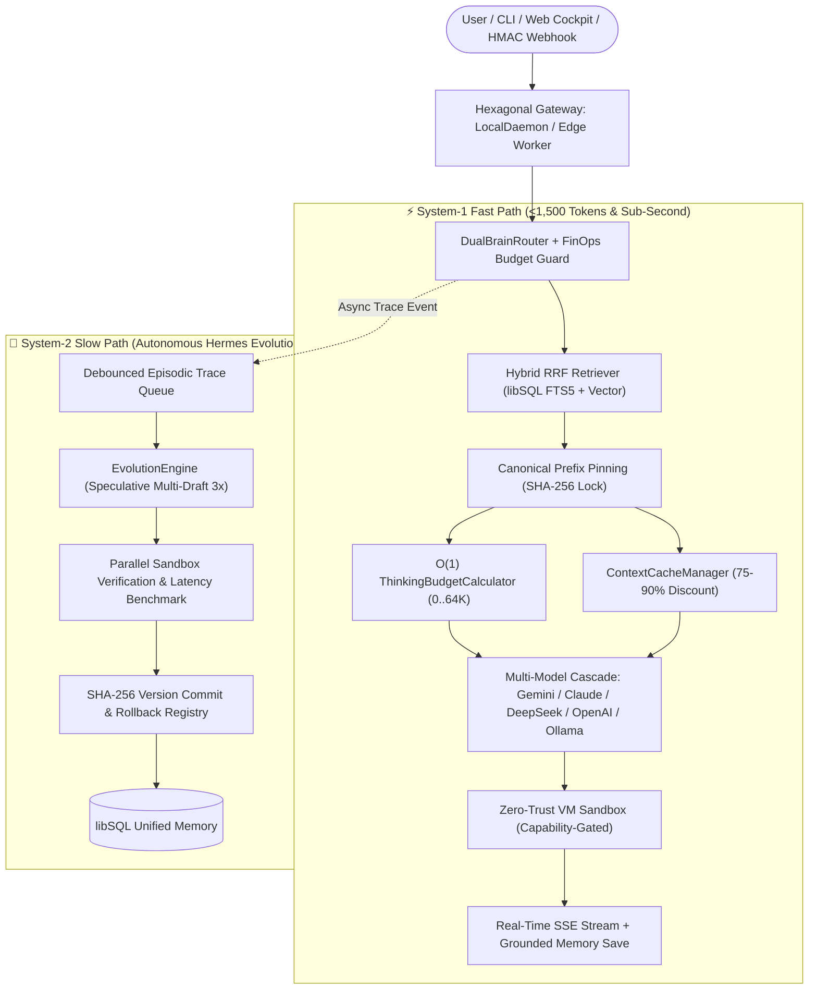

<p align="center">
  
</p>

<p align="center">
  
</p>

<h1 align="center">🦅🪽 OpenTalon (v0.5.0)</h1>

<p align="center">
  <strong>The Sovereign Fusion of Hermes Self-Evolution &amp; OpenClaw Token Frugality</strong><br>
  <em>Combining <strong>Hermes</strong> (Cybernetic Wings &amp; Caduceus DNA closed-loop procedural skill evolution) with <strong>OpenClaw</strong> (Titanium Talon surgical tool grip, &lt;1,500 tokens/turn frugality &amp; Zero-Trust Hexagonal Sandbox) + <strong>Gemini Agent Booster</strong> (O(1) Thinking Budget &amp; 90% KV-Cache).</em>
</p>

<p align="center">
  <a href="https://github.com/roedyrustam/opentalon/actions"></a>
  <a href="LICENSE"></a>
  <a href="https://github.com/roedyrustam/opentalon"></a>
  <a href="https://www.typescriptlang.org/"></a>
  <a href="https://nodejs.org/"></a>
  <a href="https://modelcontextprotocol.io/"></a>
  <a href="CONTRIBUTING.md"></a>
</p>

<p align="center">
  <a href="#-quick-start-60-seconds">Quick Start</a> •
  <a href="#-whats-new-in-v050">What's New in v0.5.0</a> •
  <a href="#-architecture-overview">Architecture</a> •
  <a href="#-cli-command-suite">CLI Reference</a> •
  <a href="#-web-cockpit-dashboard-8-tabs">Web Cockpit</a> •
  <a href="#-contributing--community-roadmap">Contribute</a> •
  <a href="#-ringkasan-bahasa-indonesia">Bahasa Indonesia</a>
</p>

---

## 🌟 Why OpenTalon?

Most AI agent frameworks burn **10,000–40,000 tokens per turn**, execute arbitrary untrusted code on your host machine, and repeat the same mistakes without learning. **OpenTalon** fixes all three:

| Capability | Legacy Frameworks | Hermes Agent | OpenClaw | **🦅 OpenTalon v0.5.0** |
| :--- | :--- | :--- | :--- | :--- |
| **Token Economy** | 8k–30k tokens/turn | Variable | &lt;2,000 tokens/turn | **&lt;1,500 tokens/turn + Canonical KV-Cache (75–90% saved)** |
| **Thinking Budget** | Static / Unbounded | Fixed reflection | None | **O(1) Dynamic Entropy Budgeter (`0` to `65,536` tokens)** |
| **Skill Evolution** | Static tools | Single-draft reflection | Manual plugins | **3x Speculative Multi-Draft Synthesis + Sandbox Benchmark** |
| **Tool Security** | Raw host shell | High-risk shell | Permissive plugins | **Zero-Trust Sandboxed VMs (`net` / `fs` / `env` / `skills`)** |
| **Proactive Daemon** | External cron only | None | Gateway polling | **Built-in 1s Heartbeat Scheduler + HMAC Webhook Ingress** |
| **Multimodal & Grounding** | External wrappers | Text only | Text only | **Native Vision/PDF/Audio `inlineData` + Auto-Saved Web Citations** |
| **FinOps Governance** | None | None | Prompt pruning | **Live USD Spend Ledger + 80% Daily Frugal Throttle Guard** |
| **Swarm & MCP** | Heavy add-ons | Single-agent | Community plugin | **Native 3 Swarm Topologies + Full MCP v1.x Server & Client** |

---

## 🔥 What's New in v0.5.0

1. **⚡ Gemini Agent Booster Engine (`@opentalon/core`)**
   - **`ThinkingBudgetCalculator`**: Zero-latency (`O(1)`) task entropy evaluator scoring lexical complexity, code blocks, security/architecture keywords, tool count, and multimodal attachments to dynamically allocate `0` to `65,536` System-2 thinking tokens.
   - **Canonical KV-Cache Prefix Pinning (`TokenBudgeter`)**: Alphabetically canonicalizes `ToolDefinition[]`, nested JSON Schema keys, and `SemanticFact[]` (`category:key`) with SHA-256 fingerprinting (`prefixHash`) to guarantee 100% byte-identical prompt prefixes across turns.
   - **Auto-Wired `ContextCacheManager`**: Tracks implicit prefix reuse and explicit Gemini `cachedContents` (75–90% cost discount) with bounded LRU eviction (`maxEntries: 200`) and automatic failover (`gemini-4-pro` / `gemini-4-argon` $\rightarrow$ `gemini-3.8-flash`).
2. **🖼️ Native Multimodal Vision, PDF & Audio Grounding**
   - Attach images, screenshots, PDFs, or audio clips (`MultimodalAttachment`) directly via API or the Web Cockpit's **`📎 Attach`** bar.
3. **🌐 Autonomous Grounded Research Memory**
   - Verified Google Search Grounding citations (`GroundingMetadata.sources`) are automatically persisted into `semantic_facts` (`category: 'grounded_research'`) so future turns recall verified facts at **0 search cost**.
4. **🧬 Speculative Multi-Draft Skill Evolution**
   - `EvolutionEngine` concurrently synthesizes $N$ candidate `SKILL.md` implementations across varied temperatures (`0.1`, `0.35`, `0.6`, `0.8`, `0.9`), benchmarks every candidate inside the Zero-Trust Sandbox, and commits the fastest passing winner (`talon evolve --speculative 3`).
5. **💰 Sovereign FinOps Cost Envelope & Frugal Throttle Guard**
   - Tracks real-time USD cost and KV-cache USD savings per model (`FinOpsBudgetTracker`). Automatically activates a **Frugal Throttle Guard** at $\ge 80\%$ daily budget utilization, capping `thinkingBudget` at $\le 2,048$ tokens to prevent runaway API bills.
6. **⏰ Proactive Heartbeat Scheduler & HMAC Webhook Ingress**
   - Built-in `CronScheduler` supporting UNIX cron (`*/15 * * * *`), aliases (`@hourly`, `@daily`), and natural intervals (`every 30s`, `every 15m`) with **0-Token Direct Skill Execution** and `POST /api/webhooks/:name` HMAC SHA-256 verification.
7. **🤝 A2A Protocol & Multi-Daemon P2P Mesh Federation (v0.6.0)**
   - Decentralized Peer-to-Peer mesh federation powered by auto-generated **Ed25519 asymmetric keypairs** stored in SQLite (`agent_identity`).
   - Discovers nodes via standard **`/.well-known/agent.json` Agent Cards**.
   - Zero-token capability negotiation (`POST /api/a2a/negotiate`) and signed task delegation (`POST /api/a2a/dispatch`) with replay attack shields (`nonce` deduplication cache + $\pm60$s skew check) and circular delegation loop prevention (`delegationDepth <= 3`).

---

## 🏗️ Architecture Overview

OpenTalon implements a **Hexagonal Ports & Adapters** architecture powered by a **Dual-Brain Execution Protocol**:



---

## 🚀 Quick Start (60 Seconds)

### 1. Prerequisites
- **Node.js**: `v22.0.0+`
- **pnpm**: `v9.0.0+`

### 2. Clone, Install & Verify
```bash
git clone https://github.com/roedyrustam/opentalon.git
cd opentalon

# Install workspace dependencies
pnpm install

# Build all 5 monorepo packages
pnpm build

# Run the 139 unit & integration tests across 21 test files (completes in ~2.5s)
pnpm test
```

### 3. Initialize & Launch the 9-Tab Web Cockpit
```bash
# Initialize local SQLite database & seed 6 production skills
pnpm talon init

# Configure your LLM provider key (supports Gemini, Claude, DeepSeek, OpenAI, or 100% offline Ollama)
cp .env.example .env

# Start the Local Daemon + 9-Tab Web Cockpit on http://127.0.0.1:3100
pnpm talon serve --port 3100
```

---

## 🖥️ Web Cockpit Dashboard (9 Built-In Tabs)

Open `http://127.0.0.1:3100/dashboard` in your browser to access the zero-dependency dark-mode Cockpit:
1. **Overview & 3D Holographic Core**: Live 60FPS interactive 3D core, KV-Cache savings counter, System-2 thinking telemetry, and 1-click Speculative Evolution trigger.
2. **Episodic Traces**: Inspect every turn's prompt, retrieved skills, token breakdown, and latency.
3. **Procedural Skills & Sandbox Tester**: Browse, create, delete, or live-test `SKILL.md` packages inside the Zero-Trust Sandbox.
4. **Swarm Topologies**: Visually dispatch **Fan-Out / Fan-In**, **Pipeline Saga**, and **Critic-Validator Loop** multi-agent swarms.
5. **MCP Hub**: Inspect native Model Context Protocol (MCP v1.x) JSON-RPC tools or import remote MCP servers.
6. **Semantic Memory**: Search FTS5 declarative facts, user preferences, and auto-saved **Grounded Web Research** citations.
7. **Live Playground**: Real-time SSE token streaming with **Google Search Grounding**, **Thinking Budget Selector**, and **📎 Multimodal Attachment (Image/PDF/Audio)** upload.
8. **Automations & Cron Manager**: One-click automation presets, custom cron/interval jobs, manual triggers, and live audit logs.
9. **A2A Mesh Federation**: Inspect local Ed25519 node identity & Agent Card (`/.well-known/agent.json`), manage federated peer registry, auto-discover remote nodes, and monitor cryptographic audit logs.

---

## 💻 CLI Command Suite

```bash
# 1. Single-shot Fast Path execution
pnpm talon run "Convert 250 USD to IDR and calculate 11% VAT"

# 2. Interactive Dual-Brain REPL Chat
pnpm talon chat

# 3. Agent-to-Agent (A2A) Protocol & P2P Mesh Federation (v0.6.0)
pnpm talon a2a identity                                     # View node URN, Ed25519 public key, and active skills
pnpm talon a2a peers                                        # List all registered federated peers
pnpm talon a2a register http://192.168.1.50:3100            # Auto-discover remote peer via Agent Card
pnpm talon a2a ping peer-remote-node-1                      # Test round-trip latency to a peer node
pnpm talon a2a dispatch peer-remote-node-1 "Extract tables" # Signed remote subagent dispatch

# 4. Gemini Agent Booster — Evaluate Task Entropy & Thinking Budget
pnpm talon booster evaluate "Refactor distributed concurrency lock and verify invariants" --tools 3
pnpm talon booster status

# 5. Sovereign FinOps — Inspect Token Ledger, USD Savings & Frugal Throttle
pnpm talon finops

# 6. Autonomous Slow-Path Evolution (with 3x Speculative Multi-Draft Benchmarking)
pnpm talon evolve --speculative 3

# 7. Autonomous Cron & Heartbeat Scheduler
pnpm talon cron list
pnpm talon cron add --name "api-watch" --cron "every 15m" --skill http_json_fetcher --args '{"url":"https://api.github.com"}'
pnpm talon cron trigger api-watch
pnpm talon cron logs

# 8. Multi-Agent Swarm Orchestration
pnpm talon swarm fanout "Design a zero-downtime PostgreSQL migration strategy"
pnpm talon swarm saga "Extract requirements -> Design OpenAPI schema -> Generate TypeScript client"
pnpm talon swarm critic "Write a constant-time HMAC signature verifier"

# 9. Whole-Repo Monolithic Context Caching (2M+ Token Gemini 4 Pro / 3.8 Flash)
pnpm talon analyze .
```

---

## 📦 Monorepo Architecture

| Package | Path | Description |
| :--- | :--- | :--- |
| **`@opentalon/core`** | [`packages/core`](packages/core) | `DualBrainRouter`, `ThinkingBudgetCalculator`, `FinOpsBudgetTracker`, `ContextCacheManager`, `EvolutionEngine`, `SwarmDirector`, `CronScheduler`, `McpServer`, and 7 LLM Drivers. |
| **`@opentalon/memory`** | [`packages/memory`](packages/memory) | `LibSqlMemoryAdapter` (SQLite / Turso), FTS5 BM25 full-text search, Float32 vector cosine similarity, and Reciprocal Rank Fusion (RRF). |
| **`@opentalon/skill-engine`** | [`packages/skill-engine`](packages/skill-engine) | `SandboxedVmRunner`, `VirtualFs`, `CapabilityValidator`, `SkillMarkdownParser`, `SkillSynthesizer`, `SkillVersionManager`, and `RemoteSkillInstaller`. |
| **`@opentalon/gateway`** | [`packages/gateway`](packages/gateway) | `LocalDaemonAdapter`, `ServerlessEdgeAdapter` (Cloudflare Workers), `SseStreamAdapter`, HMAC Webhook Ingress, and 8-Tab Web Cockpit. |
| **`talon` (CLI)** | [`packages/cli`](packages/cli) | Unified command-line interface for local orchestration, REPL chat, daemon management, and CI automation. |

---

## 🤝 Contributing & Community Roadmap

We welcome contributors of all experience levels! Check out [**CONTRIBUTING.md**](CONTRIBUTING.md) to get started in under 3 minutes.

### 🎯 High-Impact Ways to Contribute ("Good First Issues")
- 🧩 **New Production Skills (`examples/skills/`)**: Contribute zero-trust `SKILL.md` modules (e.g., JWT verifier, Markdown table formatter, Cron expression explainer, OpenAPI linter).
- 🔌 **New LLM & Embedding Drivers (`packages/core/src/drivers/`)**: Add adapters for Mistral, Cohere, Groq, Together AI, or AWS Bedrock implementing `ILLMPort`.
- 🌐 **Gateway & Messaging Adapters (`packages/gateway/`)**: Build ingress adapters for Discord, Telegram, Slack, or WhatsApp webhooks.
- 🧪 **Adversarial Sandbox Red-Teaming (`packages/skill-engine/`)**: Add security fuzzing tests for `SandboxedVmRunner` and `VirtualFs`.

If you find OpenTalon useful, please consider giving the repository a ⭐ **Star on GitHub** — it helps more developers discover the project!

---

## 🇮🇩 Ringkasan Bahasa Indonesia

**OpenTalon** adalah framework **AI Agent Otonom Open-Source** generasi terbaru yang menggabungkan:
1. **Self-Evolving Procedural Memory (Gaya Hermes Agent + Speculative Multi-Draft):** Agen belajar secara otonom dari kegagalan eksekusi di latar belakang (*Slow Path*), menyusun 3 kandidat `SKILL.md` secara paralel, mengujinya di sandbox, dan menyimpan kandidat tercepat.
2. **Hyper-Frugal Token Economy (Gaya OpenClaw + Gemini Agent Booster):** Menjaga anggaran *Fast Path* `< 1.500` token/turn dengan *Canonical KV-Cache Prefix Pinning* (hemat biaya 75–90%) dan *O(1) Dynamic Thinking Budget* (`0` s/d `65.536` token).
3. **Zero-Trust Capability Sandbox:** Setiap kode skill dieksekusi di dalam VM terisolasi dengan kontrol ketat atas izin jaringan (`allowedHosts`), filesystem (`VirtualFs`), environment variable, dan chaining antar-skill.
4. **Proactive Background Daemon & Sovereign FinOps:** Dilengkapi penjadwal cron internal 1 detik (`talon cron`), webhook HMAC SHA-256, dukungan Multimodal Vision/PDF, penyimpanan otomatis fakta Google Search Grounding, dan *FinOps Frugal Throttle Guard*.

---

## 📄 License

Licensed under the [MIT License](LICENSE) — Copyright © 2026 [Roedy Rustam](https://github.com/roedyrustam).
